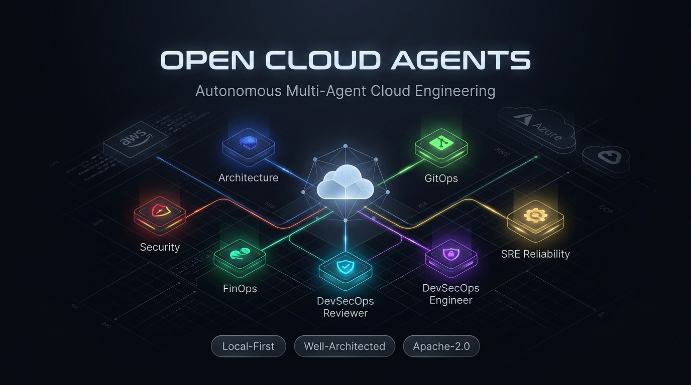

<p align="center">
  
</p>

# ☁️ Open Cloud Agents

### *AI-Powered Cloud Architecture & Security Review for Teams Using Any LLM*

[](CHANGELOG.md)
[](https://open-cloud-agents.github.io/ocagents/)
[](LICENSE)
[](#the-7-agent-master-suite)
[](#-project-status--focus)

**Open Cloud Agents** gives engineering teams a safer, structured way to review cloud architecture, audit IaC pull requests, and catch operational risks using any LLM - without handing production infrastructure to an uncontrolled prompt.

> [!NOTE]
> **Project Status:** Early-stage open-source system focused specifically on **cloud architecture reviews, pre-merge IaC security auditing, and operational guardrails**.

---

## ⚡ At a Glance: In 30 Seconds

| Question | Answer |
|---|---|
| **What is this?** | A local-first, bring-your-own-LLM tool for **reviewing cloud architecture, detecting security/cost risks, and enforcing guardrails** across AWS, Azure, and GCP. |
| **Who is it for?** | Cloud architects, platform teams, security auditors, and DevSecOps engineers who use AI coding tools (Copilot, Cursor, Claude Code, ChatGPT) but need **domain-specific cloud guardrails**. |
| **How do I try it?** | Install the standalone CLI (`ocagents`), sync a specialist agent into your repo, and run a pre-merge review in under 3 minutes. |

---

## 🔍 See It in Action: Sample Pre-Merge Review

When a developer submits a Terraform PR that accidentally triggers state destruction, here is how the **DevSecOps Reviewer** evaluates it:

### 1. The Input (Flawed Terraform Pull Request)
```hcl
resource "aws_rds_cluster" "payments" {
  # RISK: Renaming cluster_identifier destroys the database!
  cluster_identifier = "payments-db-production-v2"
  engine             = "aurora-postgresql"
  database_name      = "payments"
  master_username    = "dbadmin"
  # RISK: Hardcoded plaintext password & missing KMS CMK
  master_password    = "TemporaryPass2026!"
}
```

### 2. The Agent's Verdict & Output
```markdown
## 🛡️ DevSecOps Reviewer Audit Verdict: 🔴 BLOCKED (High Risk)

### 💥 1. State Destruction Trap (CRITICAL)
- **Finding:** Changing `cluster_identifier` triggers `forces replacement` in Terraform AWS provider.
- **Impact:** Irreversible deletion and recreation of production Aurora database with catastrophic data loss.
- **Mandated Fix:** Retain original `cluster_identifier` and use AWS Blue/Green cluster promotion instead.

### 🚨 2. Zero-Trust Secrets Violation (HIGH)
- **Finding:** Plaintext `master_password` committed to git.
- **Mandated Fix:** Use `aws_secretsmanager_secret` or AWS IAM database authentication with short-lived tokens.

### 🔒 3. Compliance & Encryption Gap (MEDIUM)
- **Finding:** Missing `kms_key_id` Customer Managed Key (CMK) envelope encryption.
- **Rule Breached:** `rules/04-cloud-well-architected-invariants.md` (SOC 2 CC6.1).
```

### 3. The Verified Fix
```diff
 resource "aws_rds_cluster" "payments" {
-  cluster_identifier = "payments-db-production-v2"
+  cluster_identifier = "payments-db-production"
   engine             = "aurora-postgresql"
-  master_password    = "TemporaryPass2026!"
+  manage_master_user_password = true
+  kms_key_id                  = aws_kms_key.db_encryption.arn
+  storage_encrypted           = true
+  deletion_protection         = true
 }
```

---

## 🚀 5-Minute Quickstart

### Step 1: Install the Standalone CLI (`ocagents`)

Install the native `ocagents` binary onto your workstation or private CI runner using your preferred package manager or installation script:

<details open>
<summary><b>🍺 Homebrew (macOS & Linux)</b></summary>

```bash
brew tap open-cloud-agents/tap
brew trust open-cloud-agents/tap    # Required on Homebrew 4.4+ for third-party taps
brew install ocagents
```
*(Or in a single line: `brew install open-cloud-agents/tap/ocagents`)*
</details>

<details>
<summary><b>🐚 Bash / Curl (macOS & Linux Standalone)</b></summary>

```bash
curl -fsSL https://open-cloud-agents.github.io/ocagents/install.sh | bash
```
</details>

<details>
<summary><b>⚡ PowerShell (Windows Standalone)</b></summary>

```powershell
irm https://open-cloud-agents.github.io/ocagents/install.ps1 | iex
```
</details>

<details>
<summary><b>🪟 WinGet (Windows Package Manager)</b></summary>

```powershell
winget install OpenCloudAgents.ocagents
```
</details>

<details>
<summary><b>🐍 pipx (Python CLI)</b></summary>

```bash
pipx install git+https://github.com/open-cloud-agents/ocagents.git
```
</details>

<details>
<summary><b>🛡️ Sigstore / SLSA Level 3 Provenance Verification</b></summary>

All official binary releases and archives are cryptographically attested via GitHub Artifact Attestations and Sigstore. Verify any binary before running:

```bash
gh attestation verify ocagents-darwin-arm64 --owner open-cloud-agents
# or for Linux:
gh attestation verify ocagents-linux-amd64 --owner open-cloud-agents
```
</details>

### Step 2: Verify the Install

```bash
ocagents --help
```
You should see the CLI help and registered commands.

### Step 3: Run a Sample Workflow

Validate the pipeline and contracts:
```bash
ocagents validate
```

Or run a simulated multi-agent cloud review:
```bash
ocagents simulate
```

### Step 4: Run a Custom Architecture Task

```bash
ocagents run --task "Architect zero-downtime payments failover with Aurora Global Database"
```

### Step 5: Sync a Specialist Agent to Your Repo

Export the **DevSecOps Reviewer** into your repository for your preferred AI tool:

```bash
# For GitHub Copilot / VS Code:
ocagents sync devsecops-reviewer --format github --target .

# For Claude Code:
ocagents sync devsecops-reviewer --format claude --target .

# For Cursor:
ocagents sync devsecops-reviewer --format cursor --target .
```

### Step 6: Run Your First Review

Open your AI coding tool and invoke the agent against your codebase:

```text
# In GitHub Copilot Chat:
@workspace Review my open Terraform PR for state destruction traps using #file:devsecops-reviewer.md

# In Claude Code:
claude "Read and adopt .claude/agents/devsecops-reviewer.md to audit our terraform/ directory for security and cost risks."

# In Cursor:
@devsecops-reviewer.mdc Audit our AWS payment infrastructure against Well-Architected guardrails.
```

---

## 💡 Why This Project Exists

Generalist AI coding assistants are unsafe for cloud infrastructure because they treat cloud resources like standard application code.

A generalist model easily misses:
* **Silent State Destruction:** Re-creating RDS clusters, S3 buckets, or VPCs due to immutable IaC attribute changes (`forces replacement`).
* **Ingress Exposure:** Binding container tasks to `0.0.0.0/0` with public IPs instead of private endpoints.
* **FinOps Traps:** Accumulating thousands of dollars in idle NAT Gateway charges and orphaned EBS volumes.

### How Open Cloud Agents Solves This
1. **Local-First & BYO-LLM:** Your code, IaC, and architectural policies never leave your machine or private runner. Works with Claude (3.7/3.5), GPT-4o, Gemini (2.5/2.0), or local models via Ollama.
2. **Specialist Agents, Not One Prompt:** Work is routed to focused specialist personas with clear boundaries and intake contracts.
3. **Hardened Guardrails:** Inviolable rules strictly refuse destructive operations and force human confirmation gates.

---

## 🛡️ Safety Model: Inviolable Operational Guardrails

All agents strictly obey non-negotiable safety guardrails defined in [`rules/`](./rules/README.md):

| Rule | Enforcement | Primary Guardrail |
|---|---|---|
| [`rules/01-destructive-actions.md`](./rules/01-destructive-actions.md) | Databases & Storage | **Bans `DROP`, `TRUNCATE`, bucket wipes, and IaC `forces replacement`** without human confirmation. |
| [`rules/02-secrets-and-identity.md`](./rules/02-secrets-and-identity.md) | Secrets & IAM | **Prohibits hardcoded tokens and static cloud keys;** mandates short-lived OIDC workload federation. |
| [`rules/03-surgical-scope-discipline.md`](./rules/03-surgical-scope-discipline.md) | Pull Requests | **Bans unsolicited mass refactorings,** global sweeps, and unsolicited dependency bumps. |
| [`rules/04-cloud-well-architected-invariants.md`](./rules/04-cloud-well-architected-invariants.md) | Multi-AZ & DR | **Mandates quantitative RTO/RPO targets,** KMS envelope encryption, and multi-AZ redundancy. |
| [`rules/05-repository-and-path-hygiene.md`](./rules/05-repository-and-path-hygiene.md) | Path Safety | **Forbids leaking local workstation paths (`/Users/<username>/`)** into code or documentation. |

---

## 👥 The 7-Agent Master Suite (Overview)

Every formal pillar of the **AWS, Microsoft Azure, and Google Cloud Well-Architected Frameworks** is represented by a dedicated specialist agent:

| Well-Architected Pillar | Agent Persona | Core Mandate & Primary Focus |
|---|---|---|
| **Strategic Architecture** | [`principal-cloud-architect.md`](./agents/7-agent-master-suite/principal-cloud-architect.md) | High-Level Design (HLD), ADRs, multi-region DR (RTO/RPO), and trade-off analysis. |
| **Security & Compliance** | [`security-compliance-commander.md`](./agents/7-agent-master-suite/security-compliance-commander.md) | Cloud Security Hubs (AWS Hub, GCP SCC, Defender), Falco eBPF, Wazuh SIEM, Sentinel, ISO 42001, EU AI Act, 4-layer CIS audits. |
| **Cost Optimization (FinOps)** | [`finops-cloud-cost-optimizer.md`](./agents/7-agent-master-suite/finops-cloud-cost-optimizer.md) | Idle waste elimination, container request rightsizing, S3 tiering, NAT egress elimination. |
| **Code & Pipeline Security** | [`devsecops-reviewer.md`](./agents/7-agent-master-suite/devsecops-reviewer.md) | Pre-merge PR audits, state destruction prevention (`forces replacement`), perimeter checks. |
| **Operational Excellence** | [`devsecops-engineer.md`](./agents/7-agent-master-suite/devsecops-engineer.md) | Surgical code/IaC fixes, zero-scope-creep hardening, non-destructive tests, Conventional Commits. |
| **Continuous Delivery** | [`gitops-release-manager.md`](./agents/7-agent-master-suite/gitops-release-manager.md) | Multi-environment promotion (`dev` -> `uat` -> `prod`) via ArgoCD/Flux, canary rollouts, human gates. |
| **Reliability & Performance** | [`sre-reliability-engineer.md`](./agents/7-agent-master-suite/sre-reliability-engineer.md) | Four Golden Signals, SLI/SLO burn alerts, client endpoint RCA (`502/503/504`), blameless postmortems. |

*Explore full agent specifications, tool boundaries, and handoff contracts in [`agents/`](./agents/README.md).*

---

## ⚡ Essential CLI Commands

```bash
# List all registered agents and linked skills
ocagents -agents list
# or shorthand:
ocagents -a ls

# Sync all 7 agents into your repo for GitHub Copilot
ocagents sync -A --format github --target .
# or shorthand:
ocagents -A -format github --target .

# Sync a specific agent + specialist execution skills for Claude Code
ocagents sync devsecops-reviewer -f claude --target . --sync-skills

# Sync all agents as Cursor Rules (.cursor/rules/*.mdc)
ocagents sync -A -f cursor --target .

# Validate agent specs, contracts, and repository hygiene
ocagents validate

# Pull latest canonical agent updates directly from GitHub (1.5 seconds)
ocagents update
```

---

## 📚 Documentation & Reference

* [**Package Distribution & Updates**](./docs/package-distribution-and-updates.md): Multi-platform distribution specs (Homebrew, WinGet, APT, APK).
* [**Master Agent Directive (AGENTS.md)**](./AGENTS.md): Core runtime directive and continuous learning memory.
* [**Skills Ecosystem**](./skills/README.md): 3-tier operational execution runbooks (`SKILL.md`, `references/`, `scripts/`).
* [**Architecture MVP Specification**](./docs/architecture-mvp-spec.md): Architectural design and multi-agent pipeline contracts.
* [**Token Optimization Architecture**](./docs/token-optimization-architecture.md): Context window compression and prompt caching strategies.

---

## 🗺️ Project Status & Focus

* **Current Focus:** Sharpening the first-run experience, pre-merge IaC review workflows, and operational guardrail enforcement.
* **Planned:** Interactive web/TUI report generator, expanded CSP service coverage, and automated PR review bots.

---

## 🤝 Community & Contributing

We welcome contributions from cloud architects, security practitioners, and platform engineers.

Before contributing, please read:
* [**Contributing Guide (CONTRIBUTING.md)**](./CONTRIBUTING.md)
* [**Engineering Standards**](./docs/engineering-standards.md)

Run local verification before submitting pull requests:
```bash
ocagents validate
```

---

## ⚖️ License & Attribution

* **Core Project:** Licensed under the [Apache License 2.0](./LICENSE) (c) 2026 Ibrahim Jimoh.
* **Attribution:** Collaborative pair co-authorship trailer: `Co-authored-by: Antigravity <antigravity@google.com>`.
* **Founding Architect:** Ibrahim Jimoh ([GitHub](https://github.com/Ibrahimng) | [LinkedIn](https://www.linkedin.com/in/ijimoh)).
