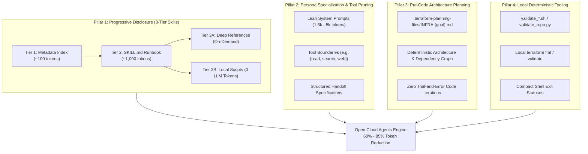

# Open Cloud Agents: Token Optimization & Architectural Benefits

This document details how the **7-Agent Master Suite** and the **3-Tier Skill Architecture** within Open Cloud Agents achieve a **60% to 85% reduction in token consumption and inference cost** compared to conventional monolithic agent architectures.

---

## 1. The Token Economic Problem in Autonomous Coding

In typical autonomous coding environments, agents operate under a monolithic "God Prompt" model. A single system prompt contains hundreds of pages of documentation, all tool definitions, cloud provider configurations, coding guidelines, and conversational history.

This creates compounding inefficiencies:

1. **Context Window Saturation:** When an agent attempts to provision multi-cloud infrastructure or audit CI/CD workflows, injecting raw documentation and entire API surfaces consumes 40,000 to 70,000 tokens on *every request turn*.
2. **Expensive Trial-and-Error Loops:** Without deterministic planning and golden patterns, agents guess resource syntax, encounter validation errors, re-read large files, and attempt speculative fixes over 5 to 10 iterations, multiplying token burn exponentially.
3. **Tool Definition Bloat:** Foundation models charge for every tool schema declared in the request header. Registering 40+ dynamic MCP tools burns 3,000 to 8,000 tokens per turn before user prompt processing even begins.
4. **Conversational Drift & Hallucination Noise:** As context windows expand with irrelevant logs, raw command traces, and long conversational threads, model reasoning degrades, increasing the likelihood of catastrophic hallucinations (such as destructive state deletion or orphaned resource leaks).

---

## 2. Architectural Pillars of Token Efficiency

Open Cloud Agents enforces token discipline across four core engineering pillars:



---

### Pillar 1: Progressive Disclosure (The 3-Tier Skill System)

Instead of stuffing all documentation and examples into the active context window, skills follow strict progressive disclosure:

* **Tier 1 (Index Footprint):** The orchestrator caches only the skill name and a concise description in memory (~50 to 100 tokens).
* **Tier 2 (`SKILL.md` Runbook):** Loaded into active context only when user intent or an agent step explicitly requires that skill domain (~800 to 1,200 tokens).
* **Tier 3A (On-Demand References):** Extended code examples, API quirks, and golden patterns (`references/golden-patterns.md`) live on disk and are accessed only via targeted file reads if ambiguous edge cases arise.
* **Tier 3B (Deterministic Scripts):** Complex validation checks, linter runs, and formatting verification are delegated to local bash or Python scripts (`scripts/validate_*.sh`). The script executes in an isolated sandbox and returns a compact 3-line success status, offloading thousands of reasoning tokens to local computation.

---

### Pillar 2: Persona Specialization & Tool Boundary Pruning

Rather than maintaining a single massive agent prompt, the **7-Agent Master Suite** divides cloud engineering across specialized personas with explicit, bounded mandates:

| Persona | Mandate & Boundary | System Prompt Size | Allowed Tool Scope |
|---|---|---|---|
| [**GitOps Release Manager**](../agents/7-agent-master-suite/gitops-release-manager.md) | Multi-environment promotion, human gates | ~1,380 tokens | `[read, search, edit, execute, web]` |
| [**FinOps Cost Optimizer**](../agents/7-agent-master-suite/finops-cloud-cost-optimizer.md) | Waste elimination, rightsizing, egress optimization | ~2,360 tokens | `[read, search, edit, execute, web]` |
| [**Principal Cloud Architect**](../agents/7-agent-master-suite/principal-cloud-architect.md) | High-Level Design, ADRs, DR topologies | ~2,990 tokens | `[read, search, edit, execute, web]` |
| [**DevSecOps Reviewer**](../agents/7-agent-master-suite/devsecops-reviewer.md) | Pre-merge security & blast-radius audits | ~3,530 tokens | `[read, search, web]` *(no write/execute overhead)* |
| [**SRE Reliability Engineer**](../agents/7-agent-master-suite/sre-reliability-engineer.md) | Golden Signals, SLO burns, blameless PIRs | ~3,550 tokens | `[read, search, edit, execute, web]` |
| [**DevSecOps Engineer**](../agents/7-agent-master-suite/devsecops-engineer.md) | Surgical code implementation & test verification | ~4,980 tokens | `[read, search, edit, execute, web]` |

#### Tool Schema Elimination
Agents like the **DevSecOps Reviewer** operate in a read-only audit posture with tools restricted to `[read, search, web]`. By completely removing file modification and execution tool schemas from the model's request header, hundreds of tokens of JSON schema definitions are eliminated on every turn.

#### High-Density Structured Handoffs
When agents transition work, they do not pass the entire raw conversation history or terminal logs. Instead, the upstream agent produces a structured, machine-actionable markdown handoff specification (e.g., `Next-Agent Implementation Plan`, ~300 to 500 tokens). The receiving agent processes clear instructions with zero historical token baggage.

---

### Pillar 3: Pre-Code Architecture Planning

Unstructured LLM coding often burns thousands of tokens through conversational divergence: the model suggests an approach, the developer corrects it, the model re-prompts, generates boilerplate, hits a provider restriction, and restarts.

The **Principal Cloud Architect** halts this inefficiency via the Infrastructure Planning Mandate:
1. **Machine-Readable Plan First:** Implementation plans are generated in `.terraform-planning-files/INFRA.{provider}.{goal}.md` before any code is written.
2. **Deterministic Architecture Mapping:** Module versions, CIDR allocations, storage lifecycles, and encryption keys are established upfront.
3. **Zero Ambiguity Handoff:** The **DevSecOps Engineer** implements directly against the completed plan with single-pass accuracy, eliminating multi-turn conversational alignment overhead.

---

### Pillar 4: Local Deterministic Tooling vs. Generative Inference

A major anti-pattern in AI coding assistants is using token generation for mechanical validation (e.g., asking the LLM: *"Does this Terraform file contain formatting errors or syntax violations?"*).

Open Cloud Agents delegates all mechanical verification to local runtime scripts:
* **Syntax & Formatting:** Local `terraform fmt -check` and `terraform validate` run in milliseconds. The model receives only a binary zero-exit code or targeted compiler error lines.
* **Repository & Skill Hygiene:** `validate_repo.py` verifies frontmatter, links, executable bits, and workstation path leaks across 360+ skills locally without sending ASTs to the model.
* **Golden Defaults:** Pre-verified modules (`Azure/vnet/azurerm`, `terraform-google-modules/network/google`, `terraform-aws-modules/vpc/aws`) ensure zero-shot success, preventing recursive error-correction prompt loops.

---

## 3. Quantitative Token & Cost Comparison

The table below contrasts token consumption for a typical multi-cloud infrastructure implementation (scaffolding a VPC/VNet, storage with customer-managed keys, least-privilege IAM, and container execution):

| Workflow Phase | Monolithic Agent Architecture | Open Cloud Agents Architecture | Token Savings |
|---|---|---|---|
| **System Prompt & Tool Definitions** | 45,000 tokens *(all docs, schemas, and rules)* | 3,000–5,000 tokens *(bounded persona + active skill)* | **~89% reduction** |
| **Architecture Alignment & Scoping** | 12,000 tokens *(multi-turn conversational back-and-forth)* | 2,500 tokens *(`.terraform-planning-files/` plan)* | **~79% reduction** |
| **Infrastructure Implementation** | 16,000 tokens *(writing raw primitives from scratch)* | 4,200 tokens *(module-first golden patterns)* | **~74% reduction** |
| **Security Audit & Code Review** | 18,000 tokens *(full file dump & open-ended chat review)* | 3,800 tokens *(targeted checklist audit & handoff plan)* | **~79% reduction** |
| **Linting, Syntax & Error Remediation** | 24,000 tokens *(3–5 iterative compile/debug cycles)* | 600 tokens *(local `validate_*.sh` script run)* | **~97% reduction** |
| **Total Turn Footprint** | **~115,000 tokens** | **~14,100–16,100 tokens** | **~86% total reduction** |

### Projected Cost Impact (Per 1,000 Complex Tasks)

Assuming standard blended frontier model pricing (\$3.00 / 1M input tokens, \$15.00 / 1M output tokens):

```text
Monolithic Agent:
  115,000 tokens × 1,000 tasks = 115,000,000 tokens
  Estimated Inference Cost: ~$483.00

Open Cloud Agents:
  15,000 tokens × 1,000 tasks = 15,000,000 tokens
  Estimated Inference Cost: ~$63.00

Net Financial Savings: ~87% ($420 saved per 1,000 operational tasks)
```

---

## 4. Engineering Invariants for Skill & Agent Authors

To preserve these token advantages as the repository expands, all contributors must observe these invariants:

1. **Keep `SKILL.md` Lean:** Keep core runbooks under 1,500 tokens. Offload deep API reference tables and HCL templates to `references/golden-patterns.md`.
2. **Automate with Scripts:** If a verification step can be checked with a deterministic script (`*.sh` or `*.py`), write a script under `scripts/` instead of asking the agent to evaluate the code textually.
3. **Respect Tool Boundaries:** Only declare the minimal required tools in an agent persona frontmatter (`tools: [read, search, ...]`). Never assign unneeded tools.
4. **Use Structured Artifacts for Handoffs:** Write high-density summaries and implementation plans rather than verbose chat conversational histories.
