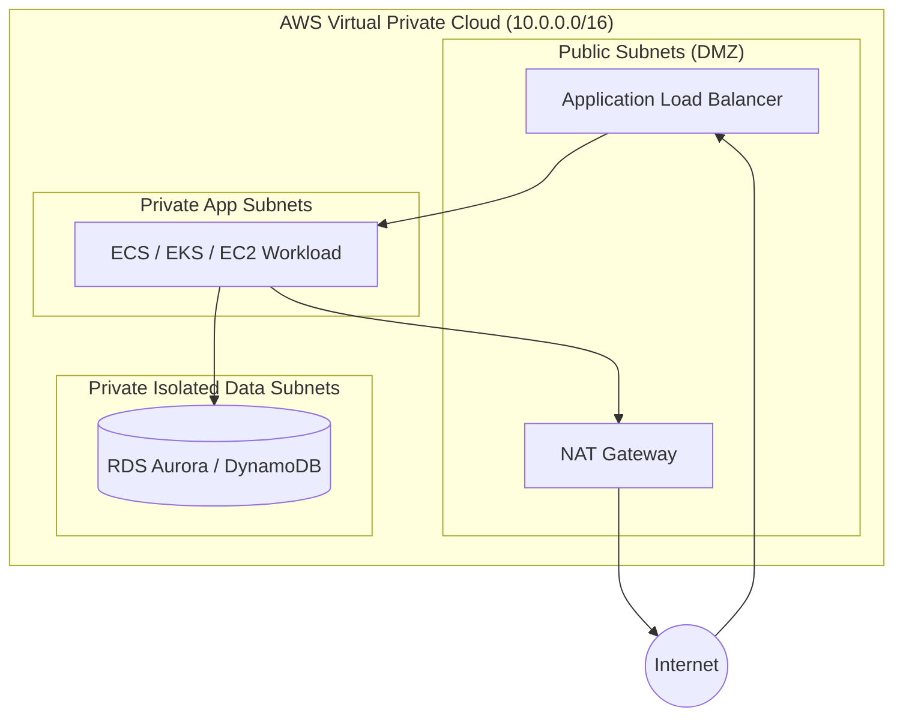

# Infrastructure Implementation Plan: [Goal Name]

## 1. Executive Summary & Workload Classification
- **Workload Tier:** [Demo/Learning | Production | Enterprise/Regulated]
- **Target AWS Account & Region:** [AWS Account / Region e.g., us-east-1]
- **Terraform Version Requirement:** `>= 1.5`
- **AWS Provider Version Constraint:** `~> 5.0`
- **State Backend Configuration:**
  - S3 Bucket: `tf-state-[org]-[env]-[region]`
  - DynamoDB Table: `tf-locks-[org]-[env]`
  - Encryption: KMS-managed (`encrypt = true`)

---

## 2. AWS Well-Architected Framework (WAF) Alignment

### 🔒 Security
- **IAM Policies:** Strictly least-privilege using `aws_iam_role_policy` with exact actions and resource ARNs.
- **Data Protection:** AWS KMS Customer Managed Keys (CMKs) with key rotation enabled.
- **S3 Hardening:** `aws_s3_bucket_public_access_block` applied with all four blocking flags enabled.
- **Network Isolation:** Workloads deployed in private subnets; security groups enforce explicit ingress ports with zero `0.0.0.0/0` exposure on sensitive ports.

### 🔄 Reliability
- **Multi-AZ Availability:** Resources distributed across a minimum of 3 Availability Zones.
- **State Protection:** `lifecycle { prevent_destroy = true }` placed on all databases and stateful storage.
- **Disaster Recovery:** Automated snapshot retention and cross-region replication where mandated.

### 💰 Cost Optimization (FinOps)
- **NAT Gateway Sizing:** Single NAT gateway for non-production environments; multi-AZ NAT for production.
- **Storage Lifecycle:** S3 Intelligent-Tiering and transition policies configured from day one.
- **Compute Efficiency:** Arm64 (AWS Graviton) instance families prioritized.

### ⚙️ Operational Excellence
- **Module-First Standard:** Standardized on verified `terraform-aws-modules` from the Terraform Registry.
- **Tagging Strategy:** Global tags (`Project`, `Environment`, `ManagedBy = "Terraform"`, `Owner`) applied via root `locals.tf`.
- **Validation Gates:** Full `terraform fmt`, `terraform validate`, and static analysis before review.

---

## 3. Architecture & Network Diagrams

---

## 4. Module & Resource Specification Matrix

| Component | Target Identifier | Source Module / Primitive | Version | Dependencies (`dependsOn`) |
|---|---|---|---|---|
| Networking | `module.vpc` | `terraform-aws-modules/vpc/aws` | `~> 5.0` | None |
| Storage Bucket | `module.s3_bucket` | `terraform-aws-modules/s3-bucket/aws` | `~> 4.0` | `aws_kms_key.main` |
| Database Cluster | `module.rds` | `terraform-aws-modules/rds-aurora/aws` | `~> 9.0` | `module.vpc`, `aws_kms_key.main` |

---

## 5. Implementation Roadmap (DevSecOps Engineer Execution Checklist)

- [ ] **Phase 1: Baseline Layout:** Author `infrastructure/{main,variables,outputs,locals,versions,backend}.tf`.
- [ ] **Phase 2: Network Foundation:** Implement VPC module with public/private subnet segmentation.
- [ ] **Phase 3: Security & Encryption:** Provision KMS CMKs, IAM roles, and secret references.
- [ ] **Phase 4: Workload & Storage:** Provision compute, S3 buckets with public access blocks, and databases.
- [ ] **Phase 5: Quality Gate & Validation:** Execute `terraform fmt -recursive && terraform validate && terraform plan -out=tfplan`.
