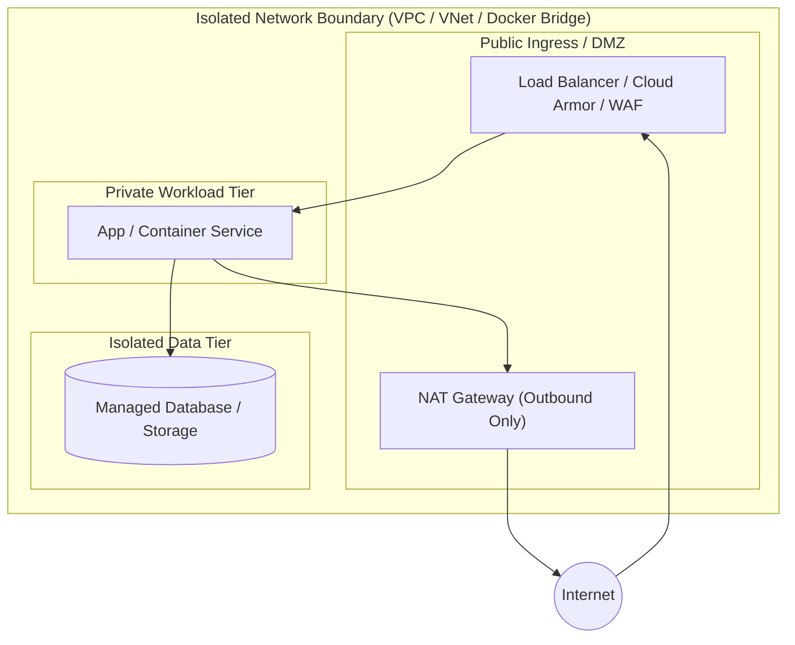

# Infrastructure Implementation Plan: [Provider] - [Goal Name]

## 1. Executive Summary & Workload Classification
- **Target Provider:** [AWS | Azure | GCP | Docker]
- **Workload Tier:** [Demo/Learning | Production | Enterprise/Regulated]
- **Target Account / Subscription / Project:** [Identifier]
- **Target Region(s):** [e.g., us-east-1, eastus2, us-central1]
- **Terraform Version Requirement:** `>= 1.5`
- **Provider Version Constraint:** [e.g., hashicorp/aws ~> 5.0 | hashicorp/azurerm ~> 3.0 | hashicorp/google ~> 5.0 | kreuzwerker/docker ~> 3.0]
- **State Backend Configuration:**
  - **AWS:** S3 Bucket `tf-state-[org]-[env]-[region]`, DynamoDB Table `tf-locks-[org]-[env]`, `encrypt = true`
  - **Azure:** Resource Group `rg-tfstate-[env]`, Storage Account `tfstate[env]sa`, Container `tfstate`, Key `[goal].tfstate`
  - **GCP:** GCS Bucket `tfstate-[project]-[env]`, Prefix `[goal]`
  - **Docker:** Local or dedicated remote state backend

---

## 2. Well-Architected Framework (WAF) Alignment

### 🔒 Security
- **Identity & Access:** Strict least-privilege policies (AWS IAM, Azure Entra ID RBAC, GCP Cloud IAM) with zero wildcard `*` permissions.
- **Data Protection:** Customer-managed keys (AWS KMS CMK, Azure Key Vault CMK with purge protection, GCP Cloud KMS CMEK with 90-day rotation).
- **Storage Hardening:** Public access blocked, private network access enforced, minimum TLS 1.2+.
- **Network Isolation:** Workloads deployed in private subnets with security groups / NSGs; no `0.0.0.0/0` exposure on management ports.
- **Container Hardening (if Docker):** Non-root user (`user = "10001:10001"`), read-only rootfs (`read_only = true`), dropped capabilities (`ALL`), explicit CPU/memory bounds.

### 🔄 Reliability
- **Redundancy:** Multi-AZ deployment across availability zones.
- **State Protection:** `lifecycle { prevent_destroy = true }` on stateful databases and storage accounts.
- **Disaster Recovery:** Automated backup retention, snapshot lifecycle, and multi-region failover paths where mandated.

### 💰 Cost Optimization (FinOps)
- **Networking Efficiency:** Single NAT gateway in non-production; multi-AZ NAT in production.
- **Storage Lifecycle:** Automated tiering (AWS S3 Intelligent-Tiering, Azure Blob Lifecycle, GCP GCS Lifecycle).
- **Compute Efficiency:** Rightsized instances, Graviton/Arm architectures, and auto-scaling triggers.

### ⚙️ Operational Excellence
- **Module-First Standard:** Standardize on verified modules (`terraform-aws-modules`, `Azure/`, `terraform-google-modules`).
- **Tagging / Labeling:** Global tags (`local.common_tags` / `local.common_labels`) applied uniformly.
- **Validation Gates:** `terraform fmt -recursive`, `terraform validate`, and dry-run `terraform plan`.

---

## 3. Architecture & Network Diagrams

---

## 4. Module & Resource Specification Matrix

| Component | Target Identifier | Source Module / Primitive | Version | Dependencies (`dependsOn`) |
|---|---|---|---|---|
| Networking | `module.network` | Verified provider module | `~> X.Y` | None |
| Storage | `resource / module` | Secure storage resource | `~> X.Y` | KMS Key |
| Database | `module.database` | Managed DB module | `~> X.Y` | `module.network`, KMS Key |

---

## 5. Implementation Roadmap (DevSecOps Engineer Execution Checklist)

- [ ] **Phase 1: Baseline Layout:** Author `infrastructure/{main,variables,outputs,locals,versions,backend}.tf`.
- [ ] **Phase 2: Network Foundation:** Implement network module with private subnet segmentation and firewall controls.
- [ ] **Phase 3: Security & Encryption:** Provision KMS CMK/CMEK keys, IAM/RBAC bindings, and secret manager references.
- [ ] **Phase 4: Workload & Storage:** Provision compute runtimes, hardened storage with public access disabled, and databases.
- [ ] **Phase 5: Quality Gate & Validation:** Execute `terraform fmt -recursive && terraform validate && terraform plan -out=tfplan`.
